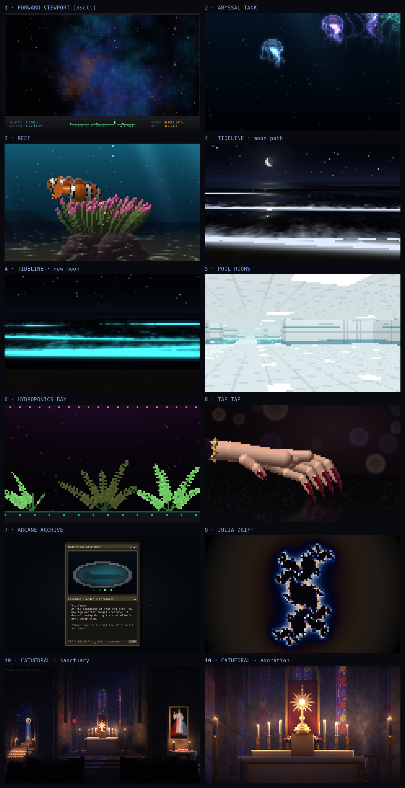

# StasisKit

*An offline, all-in-one ASCII hypersleep companion for your terminal.*

Your stasis attendant (Gemma-chan, Neon-chan, or Claude—or one you write yourself) gets you
ready for a long sleep. It runs the pod checks, sets your sleep timer, mixes the
ship's soundscape, and keeps watch while the views drift by. When the timer runs
out, the sound and the screen fade out together.

Everything is procedural: every frame is drawn live with numpy and every sound is
synthesized live. There are no samples, no loops, and no network access.



## Run it

```bash
./bin/stasiskit
```

Requirements: Python ≥ 3.11 and numpy. For sound you need one of `paplay`
(PulseAudio or PipeWire-pulse), `pw-cat`, `pacat`, `aplay`, `play` (sox) or
`ffplay`. The first one found is used. PIL is needed only for `--snapshot`.

To put it on your PATH:

```bash
ln -s ~/bin/StasisKit/bin/stasiskit ~/bin/stasiskit
```

Some useful starts:

```bash
stasiskit -t 45m                 # sleep timer: fade out over the last few minutes of 45
stasiskit -c claude -s abyss     # Claude as your companion, start at the jellyfish
stasiskit --screensaver          # no HUD or chatter, cycles views, any key exits
stasiskit --mode blocks          # hi-res half-block pixels instead of ASCII glyphs
stasiskit --list                 # views, variants, companions, sound layers
stasiskit --export-audio night.wav --minutes 60   # render your saved mix to a WAV
```

**Konsole tips:** truecolor works out of the box. A font like Hack or Noto Sans
Mono covers every glyph used. A full-screen window with a smaller font (more
cells) makes the pixel views look much richer.

## Keys

| key | |
|---|---|
| `←` `→` / `1`–`9` | change view |
| `v` / `V` | next / previous variant of this view (for cards: next card) |
| `r` | ASCII ⇄ hi-res block rendering |
| `[` `]` | dim / brighten the whole screen |
| `m` | audio mixer: `↑↓` select, `←→` level, `enter` cycle variant, `0` mute layer |
| `-` `+` / `M` | master volume / mute all |
| `t` | sleep timer: `←→` presets, `↑↓` ±1 min, `e` end action, `enter` start |
| `b` | guided breathing (in 4, hold 4, out 6, six breaths) |
| `c` / `C` | talk to your companion / switch companion |
| `s` | always show companion portrait |
| `a` | toggle auto-cycling views (default: every 7 minutes) |
| `i` | pin / hide / auto the HUD |
| `?` | help · `q` / `esc` quit |

## Views

| # | view | what it is | variants |
|---|---|---|---|
| 1 | **Forward Viewport** | 3D starfield over a painted nebula, cockpit console with a sleeping-heartbeat ECG | cockpit · open space · warp dream |
| 2 | **Abyssal Tank** | bioluminescent jellyfish that move by pulsing, with verlet tentacles, marine snow, god rays and bloom | bioluminescence · moon jellies · deep ember |
| 3 | **Reef** | a clownfish pair at home in a bubble-tip anemone. The fish are 3D point clouds with a swimming spine wave, sculling fins and full 3D turns; tentacles sway in the current and part around the fish | bubble-tip · magnificent · night reef |
| 4 | **Tideline** | the sea at night from the beach: Gerstner swells, Fresnel sky reflection, moon glitter, breakers that shoal, break, fray into lace and run up the sand, each one's crash synced to the surf sound | moon path · new moon (bioluminescent surf) · lighthouse |
| 5 | **Pool Rooms** | raycast walk through an endless tiled pool complex with caustics, glossy floors and VHS channel OSD | daylight · night swim · vapor dusk · channel surf |
| 6 | **Hydroponics Bay** | plants that sprout, grow, bloom, drop petals and reseed under grow lights | mixed · blossom trees · fern grotto · lumen coral |
| 7 | **Arcane Archive** | fantasy trading cards with animated art, foil shimmer and 3D flips | one per card |
| 8 | **Tap Tap** | ASMR: a hand drumming long stiletto nails on lacquer, each tap synced to a binaural tap sound | oxblood · chrome · pearl · french tip · neon |
| 9 | **Julia Drift** | a slowly morphing Julia set | moonlit · ember · aurora · nebula |

## Sound

The mixer has twelve layers and they can all play at once:

* **Drone**:
  * *stasis*: slow modal pad that glides between chords.
  * *lumen*: a harmonic series where single partials bloom and fade, in the
    spirit of Keith Fullerton Whitman.
  * *abyss*: sub-bass with distant hull resonances.
  * *halo*: choir-like vowel formants.
  * *orbit*: sparse soft bells.
  * *slush*: slushwave barberpole-phaser drone with slowed tape-warbled chords and diffused echo.
* **Noise**: brown, pink, white, grey (equal-loudness), deep, blue, violet.
* **Scene ambience**: follows the view you're on (engine hum, pool hall,
  whale song, reef bubbles, night surf whose waves crash in time with the
  breakers you see, trickling stream, hearth fire, room tone, solar wind).
* **Rain, ocean, wind, stream, crickets, fire, deep sea, ship hum**: each has
  its own variants.
* **Nail taps**: only sounds in Tap Tap; acrylic, glass or wood.

Drones and ambience go through a 4.8-second convolution hall reverb. All
synthesis runs in its own process, so the animation never stutters the audio.

Mixer levels, presets, your companion, render mode and per-view variants are
saved to `~/.config/stasiskit/state.json`. In-app choices resume next time, but
if you edit a setting in `config.toml` afterwards, your edit wins.

## Configuration

`stasiskit --init-config` writes `~/.config/stasiskit/config.toml`. Every key is
optional:

```toml
companion = "gemma"        # "gemma", "neon", "claude", or your own
always_show_companion = false
human_name = ""            # what your companion calls you
fps = 24
render_mode = "ascii"      # or "blocks"
autocycle = true
scene_cycle_minutes = 7    # 0 = never auto-cycle
chattiness = 2             # 0 silent .. 3 chatty
timer_fade_minutes = 3
on_timer_end = "dark"      # "dark", "dim" (night-light) or "exit"
audio_backend = "auto"     # paplay, pw-cat, pacat, aplay, sox, ffplay
```

## Make your own companion

Copy `stasiskit/companions/gemma.toml` to `~/.config/stasiskit/companions/yourname.toml`
and edit it:

* `name`, `title`, `address` (what they call you), `accent` / `accent2` colours.
* `[portrait]` is either:
  * `kind = "sprite"`: pixel-art frames, where each character is one pixel
    mapped through `palette` and `.` is transparent. Provide `idle`, `blink`,
    `talk` and optionally `happy`.
  * `kind = "spark"`: a procedural starburst, as Claude uses.
* `[lines]` holds dialogue lists for `greeting`, `idle`, `talk`, `timer_set`
  (`{duration}`), `timer_warn`, `goodnight`, `wake`, `quit`, `mixer`,
  `breathe_start`, `breathe_end`, and per-view `[lines.scene]` keys (`viewport`,
  `abyss`, `poolrooms`, `garden`, `cards`, `nails`, `julia`). Use `{human}` and
  `{name}` anywhere.

`C` cycles through every companion it finds.

## Add your own cards

The archive ships with fourteen original cards. Add your favourites (any game) as
`~/.config/stasiskit/cards/*.toml`:

```toml
[[card]]
name = "Your Card"
cost = "2UU"            # digits = generic, W U B R G = coloured pips
color = "U"             # W U B R G, M(ulti), A(rtifact), L(and)
type = "Creature — Something"
text = "Rules text.\nSecond ability."
flavor = "Flavour text."
pt = "2/3"
rarity = "mythic"       # common / uncommon / rare / mythic (more foil shimmer)
art = "space"           # pod jelly space forest fire tower vortex island crystal pool bloom comet engine aurora
```

## Inspiration and credits

Two views were inspired by other ASCII artists' work. Both StasisKit versions
are independent implementations; no code, images or video from those projects
is included here.

* **Reef**: "Clownfish & anemone" by ASCII Lab
  ([@ascii.lab](https://www.instagram.com/ascii.lab/),
  [sapozhkov/ascii-lab-public](https://github.com/sapozhkov/ascii-lab-public)).
* **Tideline**: "NIGHT TIDE" by JIN2
  ([@jin_22ee](https://instagram.com/jin_22ee),
  [JIN2-ASCII](https://github.com/JIN2-ASCII/-JIN2-ASCII)).

## For tinkerers

* `stasiskit --snapshot VIEW --mode blocks --size 160x48 --at 20 --out view.png`
  renders any view to a PNG.
* Views live in `stasiskit/scenes/`. A view subclasses `Scene` and either draws
  characters directly or returns an RGB float image that the canvas turns into
  ASCII or half-blocks. Register it in `scenes/__init__.py`.
* Sound sources live in `stasiskit/audio/sources.py`. Each one renders
  `(2, 2048)` blocks at 48 kHz.
* Tests: `python3 -I tests/fuzz.py soak` runs every view for long simulated
  stretches at extreme sizes. `python3 -I tests/fuzz.py app` drives the whole
  app with random keys, resizes and timers on a fake clock.
  `python3 -I tests/vterm_check.py` checks the renderer's output frame by frame.
  None of them play audio or touch your config.
* The renderer only sends the cells that changed since the last frame, in
  24-bit color with synchronized output. It also repaints one row per frame so
  any terminal glitch heals itself within a couple of seconds.
